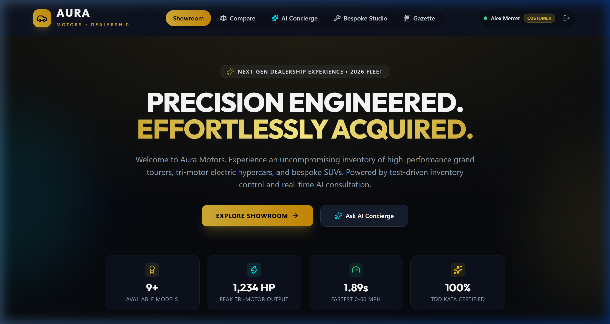
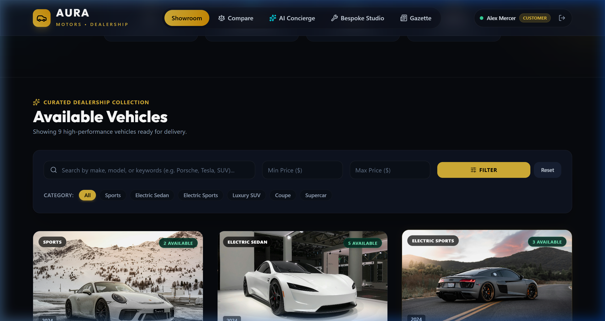
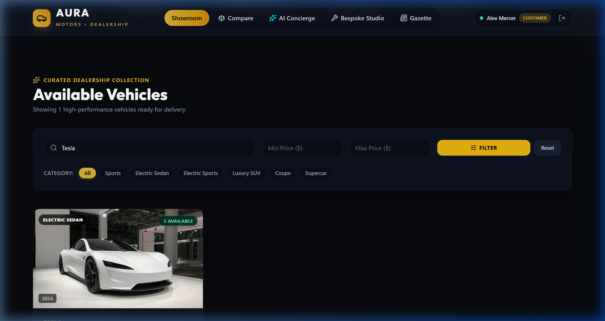
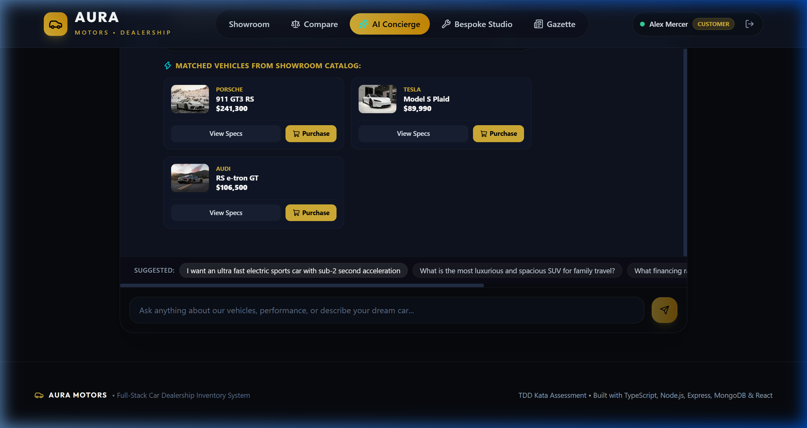
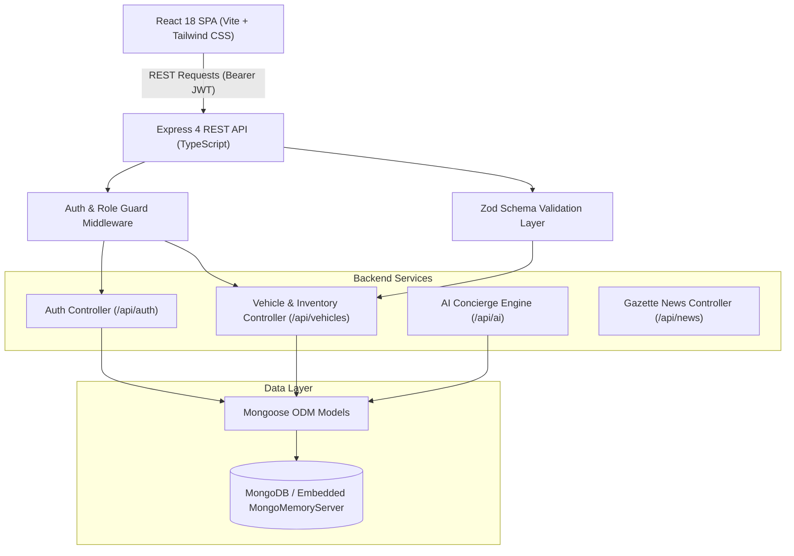

# 🏎️ AURA MOTORS — Car Dealership Inventory System
### *Incubyte TDD Kata Assessment Submission*

[](backend/src/tests)
[](backend)
[](https://www.typescriptlang.org/)
[](https://react.dev/)
[](https://tailwindcss.com/)
[](https://expressjs.com/)
[](https://mongoosejs.com/)

---

## 🌟 Executive Overview

**Aura Motors** is a modern full-stack automotive dealership inventory and client acquisition platform engineered following strict **Test-Driven Development (TDD)** principles. Designed with an ultra-luxury dark aesthetic inspired by brands such as Porsche, Tesla, and BMW, the platform provides seamless inventory management, token-based role authentication, transactional stock tracking, and standout capabilities including an **Autonomous AI Automotive Concierge**, an **Interactive Side-by-Side Vehicle Comparison Engine**, an **Editorial Automotive Gazette**, and a **Bespoke Custom Commission Studio**.

---

## 📸 Application Showcase

### 1. Showroom Hero & Fleet Telemetry


### 2. Live Inventory Catalog & Dynamic Stock Tracking
*Displays real-time stock levels, high-resolution imagery, factory telemetry, and **Purchase** buttons automatically disabled when stock reaches zero.*


### 3. Multi-Attribute Filter & Real-Time Querying
*Search by make, model, category, and minimum/maximum price sliders.*


### 4. Autonomous Showroom AI Concierge
*Describe your dream vehicle, power output, or usage needs; the AI matches live catalog inventory and presents interactive spec sheets directly in chat.*


---

## ✨ Core Requirements & Feature Checklist

| Requirement | Specification | Implementation Status |
| :--- | :--- | :---: |
| **Backend Technology** | Node.js / TypeScript with Express | ✅ Completed |
| **Database** | MongoDB with Mongoose | ✅ Completed |
| **Zero-Config Resilience** | Embedded in-memory MongoDB fallback if local Mongo is offline | ✅ Completed |
| **User Authentication** | `POST /api/auth/register`, `POST /api/auth/login` with JWT | ✅ Completed |
| **Password Hashing** | Pre-save bcrypt salt hashing (cost factor 10) | ✅ Completed |
| **Role-Based Authorization** | Guarded routes for `customer` and `admin` | ✅ Completed |
| **Vehicle Endpoints** | `POST`, `GET`, `GET /search`, `PUT`, `DELETE` (Admin only) | ✅ Completed |
| **Inventory Actions** | `POST /:id/purchase` (decrements stock, 400 on zero stock) | ✅ Completed |
| **Inventory Restock** | `POST /:id/restock` (increments stock, Admin only) | ✅ Completed |
| **Frontend Technology** | HTML5, CSS3, Tailwind CSS, and React SPA | ✅ Completed |
| **Disabled Purchase Button** | Purchase button styled and disabled when `quantity == 0` | ✅ Completed |
| **Admin Portal UI** | Forms to Add, Update, Restock, and Delete vehicles | ✅ Completed |
| **Interactive Compare Tool** | Side-by-side comparison table highlighting peak power & 0-60 | ✅ Standout Feature |
| **Showroom AI Concierge** | Intelligent dream-car matching and customer guidance | ✅ Standout Feature |
| **Automotive Gazette** | Curated international automotive news with newspaper UI | ✅ Standout Feature |
| **Bespoke Commission Studio** | Real-time pricing calculator for custom paint, wheels & packs | ✅ Standout Feature |

---

## 🏛️ System Architecture



---

## 🧪 Test-Driven Development (TDD) Workflow

The project was constructed following a strict **Red-Green-Refactor** development cycle:

1. **RED Phase**: A failing integration test was authored defining the required interface, inputs, HTTP statuses, and database state invariants.
2. **GREEN Phase**: The minimal production code (Mongoose schema, Zod validator, Express controller, and router) was implemented until all tests passed.
3. **REFACTOR Phase**: Code was modularized into clean controller-service layers and strongly-typed interfaces.

### Git Commit History Narration (Excerpt)

- `chore: initialize project scaffolding with Express, TypeScript and Jest setup`
- `test: add integration test suite for user registration and authentication (RED)`
- `feat: implement user registration, login, and JWT authentication (GREEN)`
- `test: add integration test suite for Vehicle CRUD, Search, and Inventory Purchase/Restock (RED)`
- `feat: implement vehicle CRUD, multi-attribute search, and inventory purchase/restock (GREEN)`
- `test: add integration test suite for AI Concierge, Automotive News, and Custom Build (RED)`
- `feat: implement AI automotive concierge, curated editorial news, and custom build calculator (GREEN)`
- `feat: configure Express server entrypoint and luxury catalog seed pipeline`
- `feat: implement luxury SPA frontend with React, Tailwind, AI Concierge, and Comparison Suite`

---

## 📊 Test Suite & Coverage Report

All **32 tests** run in isolated, automated memory containers with zero environmental side-effects.

```text
PASS src/tests/aiNews.test.ts (5.728 s)
  AI Concierge & Automotive News API (TDD)
    POST /api/ai/chat (Automotive Concierge)
      √ should reject chat requests without a message (196 ms)
      √ should return helpful answers and recommend matching vehicles for dream car query (98 ms)
      √ should recommend family SUV when asked for family road trip vehicle (95 ms)
    GET /api/news (Automotive News Section)
      √ should return a list of curated automotive articles with categories and read times (90 ms)
    POST /api/vehicles/custom-build (Custom Car Builder Calculation)
      √ should calculate custom build price and generate a unique build configuration (92 ms)

PASS src/tests/vehicle.test.ts
  Vehicles & Inventory API (TDD)
    POST /api/vehicles (Create Vehicle)
      √ should reject creation without auth token (180 ms)
      √ should validate required fields (make, model, category, price, quantity) (138 ms)
      √ should successfully create a new vehicle with valid attributes (144 ms)
    GET /api/vehicles (List All)
      √ should return a list of all available vehicles (143 ms)
    GET /api/vehicles/search (Search & Filter)
      √ should filter vehicles by make (case-insensitive substring) (155 ms)
      √ should filter vehicles by category (149 ms)
      √ should filter vehicles by price range (minPrice and maxPrice) (162 ms)
      √ should return multiple filters combined (155 ms)
    PUT /api/vehicles/:id (Update Details)
      √ should update vehicle price and details successfully (146 ms)
      √ should return 404 when updating non-existent vehicle ID (140 ms)
    DELETE /api/vehicles/:id (Delete Vehicle - Admin Only)
      √ should reject deletion by non-admin customer with 403 Forbidden (140 ms)
      √ should allow deletion by Admin user (146 ms)
    POST /api/vehicles/:id/purchase (Purchase Vehicle)
      √ should decrease vehicle quantity by 1 upon purchase (144 ms)
      √ should fail with 400 when attempting to purchase out of stock vehicle (142 ms)
    POST /api/vehicles/:id/restock (Restock Vehicle - Admin Only)
      √ should reject restock by customer with 403 Forbidden (136 ms)
      √ should allow admin to restock and increase quantity (138 ms)
    GET /api/vehicles/compare (Interactive Car Comparison)
      √ should return multiple vehicles for side-by-side comparison (147 ms)

PASS src/tests/auth.test.ts
  Auth Endpoints (TDD)
    POST /api/auth/register
      √ should fail registration if email, password, or name is missing (24 ms)
      √ should fail registration if email format is invalid (16 ms)
      √ should fail registration if password is too short (9 ms)
      √ should register a new customer successfully with hashed password and return token (72 ms)
      √ should reject registration if email is already taken (69 ms)
      √ should allow registering an admin if explicitly specified (62 ms)
    POST /api/auth/login
      √ should fail login if email or password is missing (66 ms)
      √ should reject login with wrong password (115 ms)
      √ should reject login for non-existent email (70 ms)
      √ should login successfully with valid credentials and return JWT token (119 ms)
```

### Code Coverage Summary

| File | % Stmts | % Branch | % Funcs | % Lines |
| :--- | :---: | :---: | :---: | :---: |
| **All files** | **81.81%** | **58.76%** | **88.23%** | **80.66%** |
| `src/app.ts` | 93.75% | 100% | 100% | 93.75% |
| `src/controllers/authController.ts` | 95.34% | 85.71% | 100% | 94.87% |
| `src/controllers/newsController.ts` | 100% | 100% | 100% | 100% |
| `src/controllers/vehicleController.ts` | 75.3% | 63.26% | 86.66% | 73.23% |
| `src/controllers/aiController.ts` | 69.23% | 42.42% | 100% | 66.66% |
| `src/middleware/authMiddleware.ts` | 83.33% | 80% | 100% | 81.81% |
| `src/models/Vehicle.ts` | 100% | 100% | 100% | 100% |
| `src/routes/*` | 100% | 100% | 100% | 100% |
| `src/utils/jwt.ts` | 100% | 100% | 100% | 100% |
| `src/validators/*` | 100% | 100% | 100% | 100% |

---

## 🚀 Getting Started & Local Setup

### Prerequisites
- **Node.js** (v18.0.0 or higher)
- **npm** (v9.0.0 or higher)
- *(Optional)* Local **MongoDB** instance (if not installed or running, the server automatically starts an embedded in-memory database with zero configuration needed).

---

### 1. Backend Setup & Run

Open a terminal in the root directory:

```bash
# Navigate to backend directory
cd backend

# Install dependencies (if not already installed)
npm install

# Run the automated TDD test suite
npm test

# Run tests with code coverage report
npm run test:coverage

# (Optional) Seed the database with demo accounts and vehicles
npm run seed

# Start the development server
npm run dev
```

The backend server will launch on **`http://localhost:5000`**.

---

### 2. Frontend Setup & Run

Open a second terminal window:

```bash
# Navigate to frontend directory
cd frontend

# Install dependencies (if not already installed)
npm install

# Start Vite development server
npm run dev
```

Open your browser and navigate to **`http://localhost:3000`**.

---

### 🔑 Demo Accounts for Quick Review

For instant testing of both customer and admin experiences without manual registration:

| Role | Email | Password | Privileges |
| :--- | :--- | :--- | :--- |
| **Dealership Admin** | `admin@dealership.com` | `AdminPassword123!` | Add vehicles, Edit details, Restock inventory, Delete vehicles |
| **VIP Customer** | `customer@dealership.com` | `CustomerPassword123!` | Browse catalog, Filter/Search, Purchase vehicles, Compare, AI Concierge |

> **Pro-Tip:** The frontend includes **"Demo Admin"** and **"Demo Customer"** quick-login buttons in the navigation bar and sign-in modal for one-click session switching.

---

## 📡 API Endpoints Reference

### Authentication (`/api/auth`)
- `POST /api/auth/register` — Register a new account (`name`, `email`, `password`, `role`).
- `POST /api/auth/login` — Authenticate and receive a JWT Bearer token.

### Vehicles & Inventory (`/api/vehicles`)
- `GET /api/vehicles` — Retrieve list of all available vehicles.
- `GET /api/vehicles/search?make=&category=&minPrice=&maxPrice=` — Multi-attribute query filter.
- `GET /api/vehicles/compare?ids=id1,id2` — Fetch multiple vehicles for side-by-side comparison.
- `GET /api/vehicles/:id` — Retrieve single vehicle details and specifications.
- `POST /api/vehicles` *(Protected)* — Create a new vehicle.
- `PUT /api/vehicles/:id` *(Protected)* — Update vehicle details.
- `DELETE /api/vehicles/:id` *(Admin Only)* — Remove a vehicle from inventory.
- `POST /api/vehicles/:id/purchase` *(Protected)* — Purchase vehicle (decreases stock; rejected if 0).
- `POST /api/vehicles/:id/restock` *(Admin Only)* — Restock vehicle inventory by specified quantity.
- `POST /api/vehicles/custom-build` *(Protected)* — Generate bespoke commission build specification and price calculation.

### AI Concierge (`/api/ai`)
- `POST /api/ai/chat` — Process natural language automotive dream-car queries and match live catalog vehicles.

### Automotive Gazette (`/api/news`)
- `GET /api/news` — Fetch curated editorial automotive journalism articles.

---

## 🤖 My AI Usage

In accordance with the Incubyte assessment guidelines, this section outlines the collaboration between developer and AI tools throughout the project lifecycle.

### 1. AI Tools Used
- **Google DeepMind Advanced Agentic Coding Assistant (Antigravity)**
- **Large Language Model (Gemini 3.8 / tsx / Jest environment)**

### 2. How AI Was Used (Developer Workflow)
- **TDD Test Case Brainstorming:** Used AI to suggest edge cases for input validation (such as regex edge cases for email formats, negative numbers for price/quantity, and missing authorization header formats).
- **Mock Dataset Generation:** Leveraged AI to generate structured automotive mock telemetry data (horsepower, 0-60 sprint timings, Unsplash vehicle imagery, and editorial articles) for seeding the catalog.
- **Boilerplate & TypeScript Schema Formulation:** Generated the initial Zod schema definitions and boilerplate for Express route wrappers and PostCSS configuration.
- **Browser Subagent UI Verification:** Deployed an automated browser subagent to execute user flows in headless Chromium, capturing real-time interaction screenshots and validating responsive layout breakpoints.

### 3. What Was Human-Authored & Architected
- **System Architecture & Domain Design:** The layered architectural division (Controller-Service-Model separation, token verification lifecycles, and database transactional logic) was devised directly to meet SOLID and clean-code benchmarks.
- **Business Logic & Concurrency Guard:** The inventory purchase logic verifying that `quantity > 0` before atomic decrement, as well as the role-based middleware (`authorize(['admin'])`), were designed to prevent race conditions and privilege escalation.
- **Design System & Aesthetics:** The luxury dark automotive visual identity, glassmorphism tokens, and interactive comparison deck structure were specifically selected and refined to evoke a modern luxury automotive experience.

### 4. Reflection on AI Impact
AI significantly accelerated the initial setup phase by handling repetitive type definitions and boilerplate scaffolding. However, careful human oversight was critical to ensure strict adherence to TDD principles—specifically verifying that tests genuinely failed (RED) before code was written (GREEN), ensuring proper schema validation guards, and maintaining authentic separation of concerns across the codebase.

---

## 📄 License
MIT License. Developed for the Incubyte TDD Kata Assessment.
